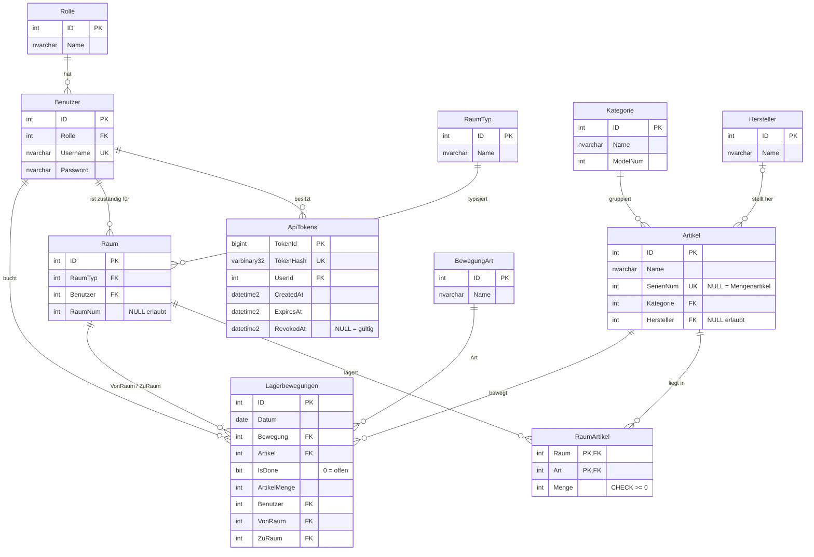

# Tutorial – So funktioniert unsere Lagerverwaltungs-API

Dieses Tutorial erklärt die REST-API `Lagerverwaltung.Api` anhand des eigenen Codes:
Einrichtung, Architektur, Datenmodell, Stored Procedures, Authentifizierung und eine zentrale
Funktion (Ausgabe und Übernahme) im Detail. Die Endpunkte selbst stehen in
[API-Dokumentation.md](API-Dokumentation.md), die Tests in [Testdokumentation.md](Testdokumentation.md).

---

## 1. Projekteinrichtung

### 1.1 Projekt und Pakete

| | |
|---|---|
| Projektvorlage | *ASP.NET Core Web API* (Controller, kein Minimal API) |
| .NET-Version | .NET 10 (`<TargetFramework>net10.0</TargetFramework>`) |
| Datenbank | SQL Server LocalDB, Datenbank `Lagerverwaltungssystem` (dieselbe wie die MVC-App aus Block 1) |
| Datenzugriff | **ausschließlich Stored Procedures** |

NuGet-Pakete (`Lagerverwaltung.Api.csproj`):

| Paket | Wofür |
|---|---|
| `Microsoft.EntityFrameworkCore.SqlServer` 10.0.15 | Verbindung zu SQL Server; wird **nur** zum Aufrufen der Prozeduren verwendet |
| `Microsoft.EntityFrameworkCore.Tools` 10.0.15 | Werkzeuge für EF Core |
| `Microsoft.AspNetCore.OpenApi` 10.0.15 | OpenAPI-Beschreibung unter `/openapi/v1.json` (nur in Development) |

Für Passwörter und Tokens wird nur `System.Security.Cryptography` aus .NET verwendet –
**kein** ASP.NET Identity und **kein** JWT-Paket.

Die C#-Methoden für die Prozeduren (`Models/LagerverwaltungssystemContextProcedures.cs` und die
`sp…Result`-Klassen) wurden mit den **EF Core Power Tools** aus der Datenbank erzeugt
(*Reverse Engineer* → nur Stored Procedures auswählen, Konfiguration in `efpt.config.json`).
Tabellen wurden absichtlich **nicht** als Entities erzeugt.

### 1.2 Datenbank einrichten

Im SQL Server Management Studio, verbunden mit `(localdb)\MSSQLLocalDB`, in dieser Reihenfolge ausführen:

1. `Lagerverwaltung.Api/Database/script.sql` – Datenbank und Tabellen aus Block 1
2. Testdaten: die MVC-App einmal starten (`SeedService` legt Rollen, Benutzer, Räume, Artikel an)
3. `Database/Schemaanpassungen.sql` – **einmal**: Anpassungen für Tokens und Sicherheit (siehe Kapitel 3.3)
4. `Database/StoredProcedures.sql` – alle Prozeduren (`CREATE OR ALTER`, darf beliebig oft ausgeführt werden)

### 1.3 Konfiguration

`appsettings.json` enthält nur den Connection String (Windows-Authentifizierung, also **kein Kennwort im Repo**):

```json
"ConnectionStrings": {
  "DefaultConnection": "Data Source=(localdb)\\MSSQLLocalDB;Initial Catalog=Lagerverwaltungssystem;Integrated Security=True;Trust Server Certificate=True"
}
```

Der **Pepper** ist geheim und steht **nie** im Repository. Er wird über User Secrets gesetzt:

```powershell
cd Lagerverwaltung.Api
dotnet user-secrets set "Security:Pepper" "<eigener geheimer Wert>"
```

API und MVC-App verwenden dieselbe `UserSecretsId` (`8d2a6fbc-…`), also auch denselben Pepper. Dadurch
können sich Benutzer in beiden Anwendungen mit demselben Kennwort anmelden.
Fehlt der Pepper, bricht die API beim ersten Login mit einer klaren Fehlermeldung ab.

### 1.4 API starten

- Visual Studio: Startprojekt `Lagerverwaltung.Api`, Profil **https**, F5 oder Strg+F5
- Konsole: `dotnet run --launch-profile https`

Die API läuft dann unter `https://localhost:7154`. Getestet wird mit `Lagerverwaltung.http`
(Anfragen von oben nach unten senden).

---

## 2. Architektur

```
HTTP-Anfrage
   │
   ▼
Controller  (Controllers/*.cs)          Route, DTO-Validierung, Token-Hash lesen
   │   Run(...) fängt THROW 504xx       → 400/401/403/404/409
   ▼
Prozedur-Wrapper  (Models/…Procedures)  von EF Core Power Tools erzeugt
   │   EXEC dbo.spXyz @TokenHash, …
   ▼
Stored Procedure  (Database/StoredProcedures.sql)
       spAuthorize prüft Token + Rolle, dann Geschäftslogik in einer Transaktion
```

| Ordner | Inhalt | Aufgabe |
|---|---|---|
| `Controllers/` | `AuthController`, `UsersController`, `CategoriesController`, `ArticlesController`, `LocationsController`, `TransfersController`, `ReturnsController`, `MovementsController`, Basisklasse `ApiControllerBase` | HTTP-Endpunkte. Sie enthalten **keine** Geschäftsregeln, nur: Eingabe lesen → Prozedur aufrufen → Statuscode zurückgeben |
| `DTOs/` | `record`-Typen wie `LoginRequest`, `ArticleRequest`, `MovementRequest` | Form der JSON-Daten und Validierung mit Attributen (`[Required]`, `[Range]`, `[StringLength]`) |
| `Services/` | `PasswordService`, `TokenService` | Kennwort-Hashing (PBKDF2 + Salt + Pepper) und Token-Erzeugung (Zufall + SHA-256) |
| `Models/` | `LagerverwaltungssystemContext`, Prozedur-Wrapper, `sp…Result` | Datenbankzugriff (generiert) |
| `Helpers/` | `SqlExceptionFilter` | Unerwartete SQL-Fehler → 500, ohne interne Details nach außen |
| `Program.cs` | | Dienste registrieren: DbContext, `PasswordService`, Controller mit Filter, HTTPS-Umleitung |

**`ApiControllerBase`** ist die Basisklasse aller Controller:

```csharp
protected readonly ILagerverwaltungssystemContextProcedures Db;     // alle Prozeduren
protected byte[]? TokenHash => TokenService.GetTokenHash(Request);   // SHA-256 des Bearer-Tokens

protected async Task<IActionResult> Run(Func<Task<IActionResult>> action)
{
    try { return await action(); }
    catch (SqlException ex) when (ex.Number >= 50400 && ex.Number <= 50499)
    {
        return StatusCode(ex.Number - 50000, new { error = ex.Message });   // 50403 → 403
    }
}
```

`[ApiController]` sorgt dafür, dass ungültige DTOs automatisch mit `400` abgelehnt werden, bevor die
Controller-Methode überhaupt läuft.

**Warum die Logik in den Prozeduren liegt:** Die Aufgabe verlangt Stored Procedures. Dadurch passieren
Berechtigungsprüfung, Bestandsänderung und Historieneintrag **in derselben Transaktion** in der Datenbank.
Der Controller kann eine Regel nicht „vergessen“.

---

## 3. Datenmodell

### 3.1 ER-Diagramm

Dasselbe Diagramm liegt als [ER-Diagramm.pdf](ER-Diagramm.pdf) bei. Es entspricht dem Schema nach `Schemaanpassungen.sql`.



### 3.2 Tabellen

| Tabelle | Bedeutung | Wichtige Schlüssel |
|---|---|---|
| `Rolle` | `Administrator`, `LehrerIn` | PK `ID` |
| `Benutzer` | Benutzerkonten, `Password` = PBKDF2-Hash | PK `ID`, FK `Rolle → Rolle.ID`, eindeutig `Username` |
| `ApiTokens` | Bearer-Tokens (nur Hash) | PK `TokenId`, FK `UserId → Benutzer.ID`, eindeutig `TokenHash` |
| `RaumTyp` | `Hauptlager`, `Umbuchungslager`, `Labor` | PK `ID` |
| `Raum` | Standorte; `Benutzer` = zuständige Person (beim Labor die LehrerIn) | PK `ID`, FK `RaumTyp`, FK `Benutzer` |
| `Artikel` | Geräte (mit Seriennummer) und Mengenartikel (ohne) | PK `ID`, FK `Kategorie`, FK `Hersteller`, eindeutig `SerienNum` (wenn nicht NULL) |
| `Kategorie`, `Hersteller` | Stammdaten | PK `ID` |
| `RaumArtikel` | **aktueller Bestand**: wie viele Stück eines Artikels in welchem Raum | PK (`Raum`, `Art`), FKs zu `Raum` und `Artikel` |
| `BewegungArt` | `Zugang`, `Ausgabe`, `Übernahme`, `Rückgabe`, `Einbuchung`, `Stornieren` | PK `ID` |
| `Lagerbewegungen` | **Historie** aller Buchungen; `IsDone = 0` = offene Ausgabe/Rückgabe | PK `ID`, FKs zu `BewegungArt`, `Artikel`, `Benutzer`, `Raum` (Von/Zu) |

### 3.3 Änderungen gegenüber Block 1 (`Database/Schemaanpassungen.sql`)

| Änderung | Begründung |
|---|---|
| `ApiTokens.RevokedAt` darf NULL sein | NULL = Token gültig, Datum = widerrufen. Vorher war „nicht widerrufen“ nicht darstellbar |
| `TokenHash`, `UserId`, `ExpiresAt` NOT NULL, `CreatedAt` mit Default | Kein Token ohne Besitzer oder ohne Ablaufzeit |
| FK `ApiTokens.UserId → Benutzer.ID` | Ein Token gehört immer zu einem echten Benutzer |
| UNIQUE `ApiTokens.TokenHash` | Schnelle Suche bei jeder Anfrage, kein Hash doppelt |
| `CHECK (RaumArtikel.Menge >= 0)` | Sicherheitsnetz: Bestand kann nie negativ werden |
| FK `Lagerbewegungen.Artikel → Artikel.ID` | Ein Artikel mit Historie kann nicht gelöscht werden |
| UNIQUE `Benutzer.Username` | Login sucht nach Benutzername |
| UNIQUE `Artikel.SerienNum` (gefiltert, ohne NULL) | Eine Seriennummer = genau ein Gerät |

---

## 4. Stored Procedures

### 4.1 Übersicht

Jede geschützte Prozedur bekommt als ersten Parameter `@TokenHash VARBINARY(32)` und ruft zuerst
`spAuthorize` auf.

| Bereich | Prozedur | Parameter (außer `@TokenHash`) | Endpunkt |
|---|---|---|---|
| Hilfe | `spAuthorize` | `@RequiredRole`, OUT `@Id`, OUT `@RoleName` | (intern) |
| Hilfe | `spBestandAendern` | `@RaumId`, `@ArtikelId`, `@Delta` | (intern) |
| Hilfe | View `vRaum` | – | (intern: Raum + Typ + Anzeigename) |
| Auth | `spGetUserForLogin` | `@Username` (kein Token) | POST login |
| Auth | `spCreateApiToken` | `@UserId`, `@TokenHash`, `@ExpiresAt` | POST login |
| Auth | `spLogout` | – | POST logout |
| Auth | `spRegister` | `@Username`, `@PasswordHash` (kein Token) | POST register |
| Benutzer | `spGetOwnUser` | – | GET users/me |
| Benutzer | `spUpdateOwnProfile` | `@NewUsername`, `@NewPasswordHash` | PUT users/me |
| Benutzer | `spGetAllUsers` | – | GET users |
| Benutzer | `spAlterUserRole` | `@UserId`, `@RoleName` | PUT users/{id}/role |
| Benutzer | `spDeleteUser` | `@UserId` (NULL = eigenes Konto) | DELETE users/me, users/{id} |
| Kategorien | `spGetAllCategories`, `spCreateCategory`, `spAlterCategory`, `spDeleteCategory` | `@Id`, `@Name`, `@ModelNum` | /api/categories |
| Artikel | `spGetAllArtikelFiltered` | `@Name`, `@SerienNum`, `@KategorieId`, `@HerstellerId`, `@RaumId` | GET articles |
| Artikel | `spGetArtikelById` | `@Id` | GET articles/{id} |
| Artikel | `spCreateArtikel`, `spAlterArtikel` | (`@Id`), `@Name`, `@SerienNum`, `@KategorieId`, `@HerstellerId` | POST/PUT articles |
| Artikel | `spDeleteArtikel` | `@Id` | DELETE articles/{id} |
| Artikel | `spAddStock` | `@ArtikelId`, `@Menge` | POST articles/{id}/stock |
| Standorte | `spGetAllRooms`, `spGetOwnRooms` | – | GET locations, locations/mine |
| Standorte | `spCreateRoom` | `@RaumTyp`, `@BenutzerId`, `@RaumNum` | POST locations |
| Standorte | `spAlterRoom` | `@Id`, `@RaumNum` | PUT locations/{id} |
| Standorte | `spAssignTeacherToLab` | `@RaumId`, `@BenutzerId` | PUT locations/{id}/teacher |
| Standorte | `spDeleteRoom` | `@Id` | DELETE locations/{id} |
| Standorte | `spGetLocationInventory` | `@RaumId` | GET locations/{id}/inventory |
| Übergaben | `spCreateTransfer` | `@LaborId`, `@ArtikelId`, `@Menge` | POST transfers |
| Übergaben | `spGetPendingTransfers` | – | GET transfers/pending |
| Übergaben | `spConfirmTransfer` | `@TransferId` | POST transfers/{id}/confirm |
| Rückgaben | `spCreateReturn` | `@LaborId`, `@ArtikelId`, `@Menge` | POST returns |
| Rückgaben | `spGetPendingReturns` | – | GET returns/pending |
| Rückgaben | `spAcceptReturn` | `@ReturnId` | POST returns/{id}/accept |
| Historie | `spGetAllMovements` | `@RaumId`, `@ArtikelId` | GET movements |

### 4.2 Fehler melden: `THROW 504xx`

Die Prozeduren melden fachliche Fehler mit einer Fehlernummer, deren letzte drei Stellen der HTTP-Status sind:

```sql
THROW 50409, N'Nicht genügend Bestand vorhanden.', 1;   -- wird zu HTTP 409
```

| Nummer | HTTP | Beispiel |
|---|---|---|
| 50400 | 400 | „Die Menge muss mindestens 1 sein.“ |
| 50401 | 401 | „Nicht angemeldet oder Token ungültig/abgelaufen.“ |
| 50403 | 403 | „Kein Zugriff auf diesen Standort.“ |
| 50404 | 404 | „Artikel nicht gefunden.“ |
| 50409 | 409 | „Diese Übergabe wurde bereits bestätigt.“ |

### 4.3 Wie ruft C# eine Prozedur auf?

Die EF Core Power Tools erzeugen für jede Prozedur eine Methode. Beispiel `spConfirmTransferAsync`
(gekürzt aus `Models/LagerverwaltungssystemContextProcedures.cs`):

```csharp
var sqlParameters = new[]
{
    new SqlParameter { ParameterName = "TokenHash",  Size = 32, Value = tokenHash ?? Convert.DBNull, SqlDbType = SqlDbType.VarBinary },
    new SqlParameter { ParameterName = "TransferId",            Value = transferId ?? Convert.DBNull, SqlDbType = SqlDbType.Int },
    parameterreturnValue,
};
var _ = await _context.Database.ExecuteSqlRawAsync(
    "EXEC @returnValue = [dbo].[spConfirmTransfer] @TokenHash = @TokenHash, @TransferId = @TransferId",
    sqlParameters, cancellationToken);
```

Die Werte werden als **SQL-Parameter** übergeben, nie als zusammengesetzter Text – SQL-Injection ist dadurch
nicht möglich. Prozeduren, die Zeilen zurückgeben, liefern eine Liste der passenden `sp…Result`-Klasse
(z. B. `List<spGetLocationInventoryResult>`), die der Controller direkt als JSON zurückgibt.

---

## 5. Bearer-Authentifizierung und Berechtigungen

### 5.1 Kennwörter: Salt und Pepper (`Services/PasswordService.cs`)

```
hash = PBKDF2-HMAC-SHA256( UTF8(kennwort + pepper), salt, 600 000 Iterationen, 32 Byte )
gespeichert: PBKDF2-SHA256$600000$<salt Base64>$<hash Base64>
```

| Teil | Woher | Wo gespeichert | Zweck |
|---|---|---|---|
| **Salt** | 16 zufällige Bytes, bei **jedem** Hash neu (auch bei jeder Kennwortänderung) | in der DB, im Hash-String | gleiche Kennwörter → verschiedene Hashes; Rainbow-Tables nutzlos |
| **Pepper** | User Secrets `Security:Pepper` | **nur** auf dem Server, nie in DB oder Git | gestohlene Datenbank allein reicht nicht zum Knacken |
| **600 000 Iterationen** | Konstante, im Hash-String mitgespeichert | | jeder Rateversuch ist langsam (OWASP-Empfehlung) |

**Prüfung beim Login** (`PasswordService.Verify`): Salt und Iterationen aus dem gespeicherten String lesen,
den Hash mit dem eingegebenen Kennwort und dem Pepper neu berechnen und mit
`CryptographicOperations.FixedTimeEquals` vergleichen. Dieser Vergleich dauert immer gleich lang, egal
wie viele Bytes stimmen – die Antwortzeit verrät nichts.

Die Datenbank bekommt **nie** das Klartext-Kennwort: `spGetUserForLogin` liefert nur den gespeicherten Hash,
die Prüfung passiert in C#.

### 5.2 Opaque Tokens (`Services/TokenService.cs`)

```csharp
byte[] bytes = RandomNumberGenerator.GetBytes(32);              // 256 Bit kryptografischer Zufall
string token = Base64Url(bytes);                                 // an den Client
byte[] hash  = SHA256.HashData(Encoding.UTF8.GetBytes(token));   // in die Datenbank
```

- Das Token ist reiner Zufall – es enthält weder Benutzer noch Rolle (anders als ein JWT).
- In `ApiTokens` steht nur der SHA-256-Hash. Wer die Tabelle stiehlt, kann sich damit nicht anmelden.
  Ein Salt ist hier nicht nötig, weil 256 zufällige Bits nicht erraten werden können.
- Lebensdauer: 60 Minuten (`TokenService.Lifetime`), gespeichert in `ExpiresAt`.
- **Widerruf:** `spLogout` setzt `RevokedAt`. Bei einer Kennwortänderung werden alle anderen Tokens widerrufen.

### 5.3 Token-Prüfung (`spAuthorize`)

```sql
SELECT  @Id = b.ID, @RoleName = r.Name
FROM    dbo.ApiTokens t
JOIN    dbo.Benutzer b ON b.ID = t.UserId
JOIN    dbo.Rolle    r ON r.ID = b.Rolle
WHERE   t.TokenHash = @TokenHash
  AND   t.RevokedAt IS NULL
  AND   t.ExpiresAt > SYSUTCDATETIME();

IF @Id IS NULL
    THROW 50401, N'Nicht angemeldet oder Token ungültig/abgelaufen.', 1;

IF @RequiredRole IS NOT NULL
   AND @RoleName NOT IN (SELECT TRIM(value) FROM STRING_SPLIT(@RequiredRole, ','))
    THROW 50403, N'Keine Berechtigung für diese Aktion.', 1;
```

Jede geschützte Prozedur beginnt damit, z. B. Administratorfunktionen:

```sql
EXEC dbo.spAuthorize @TokenHash, N'Administrator', @Id = @UserId OUTPUT;
```

### 5.4 Laborberechtigung

Für Funktionen, die beide Rollen dürfen, wird `@RequiredRole = NULL` übergeben und danach geprüft,
ob das Labor der LehrerIn gehört (`Raum.Benutzer = @UserId`). Beispiel aus `spConfirmTransfer`:

```sql
IF @OwnerId <> @UserId
    THROW 50403, N'Nur die zuständige LehrerIn kann diese Übergabe bestätigen.', 1;
```

Bei Listen (offene Übergaben, Historie, Artikelbestand) filtert die Prozedur für eine LehrerIn auf das eigene
Labor. Ein Filter auf ein fremdes Labor (`raumId`) ergibt `403`.

---

## 6. Zentrale Funktion im Detail: Ausgabe und digitale Übernahme

### 6.1 Ablauf

```
Administrator                     API / Datenbank                          LehrerIn Dennis
POST /api/transfers  ───────────► spCreateTransfer
{laborId:4, artikelId:24,         Hauptlager −4, Ausgabe (offen)
 menge:4}            ◄─────────── 201 {id: 58}
                                                                   GET /api/transfers/pending
                                  spGetPendingTransfers   ◄──────── (sieht Übergabe 58)
                                                                   POST /api/transfers/58/confirm
                                  spConfirmTransfer       ◄────────
                                  Labor +4, Ausgabe abgeschlossen,
                                  neue Zeile Übernahme   ──────────► 204
```

### 6.2 Controller (`Controllers/TransfersController.cs`)

```csharp
[HttpPost]
public async Task<IActionResult> Create([FromBody] MovementRequest request)
{
    return await Run(async () =>
    {
        var result = await Db.spCreateTransferAsync(TokenHash, request.LaborId, request.ArtikelId, request.Menge);
        int id = result.Single().NewId!.Value;
        return Created($"/api/transfers/{id}", new CreatedResponse(id));
    });
}
```

- `MovementRequest` hat nur `LaborId`, `ArtikelId`, `Menge` (mit `[Required]` und `[Range(1, 100000)]`).
  **Quelle und Bewegungsart kann der Client nicht angeben** – die Prozedur nimmt immer das Hauptlager.
- Ist die Menge 0, antwortet `[ApiController]` schon mit `400`, die Datenbank wird gar nicht aufgerufen.
- Wirft die Prozedur `THROW 50409`, macht `Run` daraus `409`.

### 6.3 Prozedur `spCreateTransfer` – Ausgabe anlegen

```sql
EXEC dbo.spAuthorize @TokenHash, N'Administrator', @Id = @UserId OUTPUT;   -- 401 / 403

-- Prüfungen: Menge >= 1, Artikel existiert, Seriennummer nur Menge 1, Labor existiert, Hauptlager existiert

BEGIN TRAN;
    DECLARE @Minus INT = -@Menge;
    EXEC dbo.spBestandAendern @HauptlagerId, @ArtikelId, @Minus;   -- 409 wenn zu wenig Bestand

    INSERT INTO dbo.Lagerbewegungen (Datum, Bewegung, Artikel, IsDone, ArtikelMenge, Benutzer, VonRaum, ZuRaum)
    VALUES (CAST(SYSDATETIME() AS DATE),
            (SELECT ID FROM dbo.BewegungArt WHERE Name = N'Ausgabe'),
            @ArtikelId, 0, @Menge, @UserId, @HauptlagerId, @LaborId);   -- IsDone = 0: offen
COMMIT;
```

Der Bestand verlässt das Hauptlager **sofort** (reserviert). Bis zur Bestätigung steht die Menge nur in der
offenen Ausgabe – nicht im Hauptlager und nicht im Labor. Dadurch kann sie weder doppelt gezählt noch ein
zweites Mal ausgegeben werden.

### 6.4 Negativer Bestand ist unmöglich: `spBestandAendern`

```sql
UPDATE dbo.RaumArtikel
SET    Menge = Menge + @Delta
WHERE  Raum = @RaumId AND Art = @ArtikelId AND Menge >= -@Delta;

IF @@ROWCOUNT = 0
    THROW 50409, N'Nicht genügend Bestand vorhanden.', 1;
```

Prüfen und Abziehen passieren in **einer** Anweisung. Zwei gleichzeitige Ausgaben können also nicht beide
„genug Bestand“ sehen und dann zu viel abziehen. Zusätzlich verhindert `CHECK (Menge >= 0)` in der Tabelle
negative Werte.

### 6.5 Prozedur `spConfirmTransfer` – digitale Übernahme

```sql
EXEC dbo.spAuthorize @TokenHash, NULL, @Id = @UserId OUTPUT;   -- jede angemeldete Person, Prüfung folgt

BEGIN TRAN;
    SELECT  @ArtikelId = b.Artikel, @Menge = b.ArtikelMenge, @LaborId = b.ZuRaum,
            @IsDone = b.IsDone, @Art = ba.Name, @OwnerId = r.Benutzer
    FROM    dbo.Lagerbewegungen b WITH (UPDLOCK, ROWLOCK)      -- Zeile sperren
    JOIN    dbo.BewegungArt ba ON ba.ID = b.Bewegung
    JOIN    dbo.Raum        r  ON r.ID  = b.ZuRaum
    WHERE   b.ID = @TransferId;

    IF @Art IS NULL OR @Art <> N'Ausgabe' THROW 50404, N'Übergabe nicht gefunden.', 1;
    IF @OwnerId <> @UserId THROW 50403, N'Nur die zuständige LehrerIn kann diese Übergabe bestätigen.', 1;
    IF @IsDone = 1        THROW 50409, N'Diese Übergabe wurde bereits bestätigt.', 1;

    UPDATE dbo.Lagerbewegungen SET IsDone = 1 WHERE ID = @TransferId;   -- Ausgabe abgeschlossen
    EXEC dbo.spBestandAendern @LaborId, @ArtikelId, @Menge;              -- Labor gutschreiben
    INSERT INTO dbo.Lagerbewegungen (…) VALUES (… N'Übernahme' …);      -- Historie
COMMIT;
```

**Wie wird doppeltes Bestätigen verhindert?** `WITH (UPDLOCK, ROWLOCK)` sperrt die Übergabe-Zeile bis zum
`COMMIT`. Kommen zwei Bestätigungen gleichzeitig, wartet die zweite, liest danach `IsDone = 1` und bekommt `409`.
Getestet: 5 gleichzeitige Bestätigungen derselben Übergabe → genau 1 erfolgreich, 4 × `409`.

`SET XACT_ABORT ON` und `TRY … CATCH` mit `ROLLBACK` sorgen dafür, dass bei jedem Fehler **alles**
zurückgenommen wird – es gibt nie „Bestand gebucht, aber keine Historie“.

### 6.6 Rückgabe (kurz)

- `spCreateReturn` (LehrerIn): Labor −Menge, **Umbuchungslager** +Menge, Bewegung „Rückgabe“ offen.
  Das Ziel ist fest in der Prozedur – eine LehrerIn kann nie direkt ins Hauptlager buchen.
- `spAcceptReturn` (Administrator): Umbuchungslager −Menge, Hauptlager +Menge, Rückgabe abgeschlossen,
  neue Bewegung „Einbuchung“. Gleiche Sperre wie beim Bestätigen, ein zweites Annehmen gibt `409`.

---

## 7. API-Tests

Ein vollständiger Geschäftsprozess mit den echten Antworten der API steht in
[Testdokumentation.md](Testdokumentation.md).
